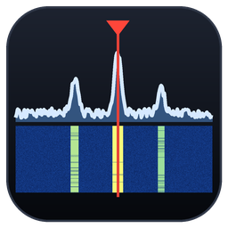
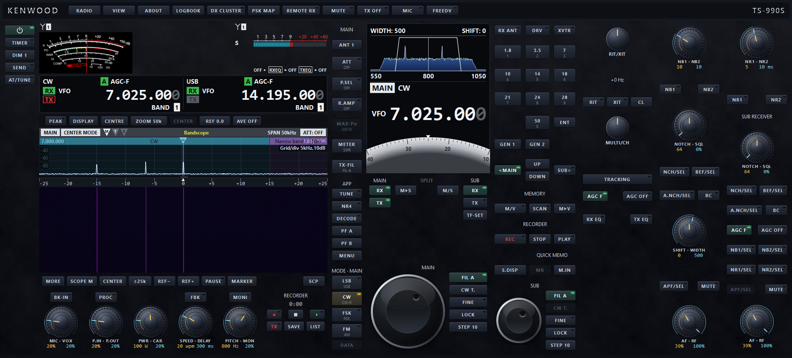
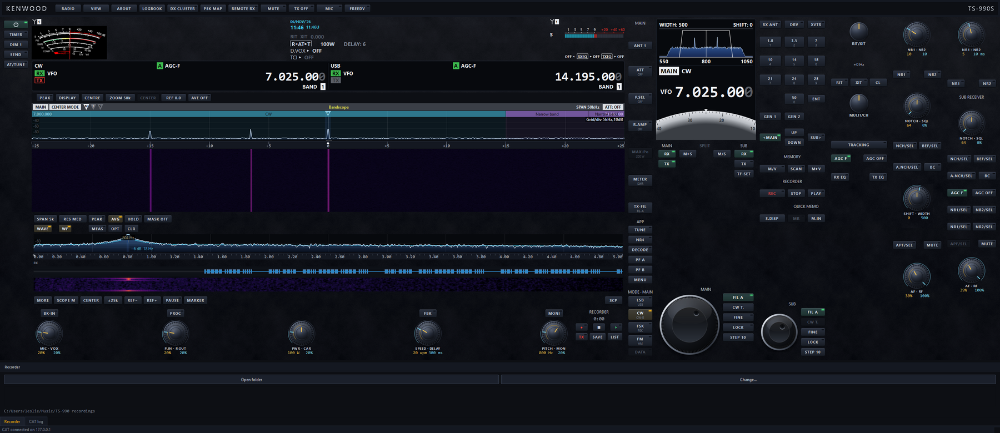
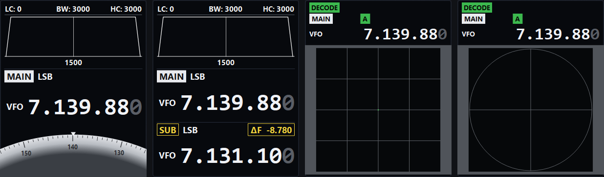
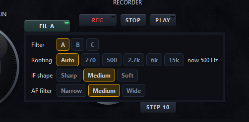
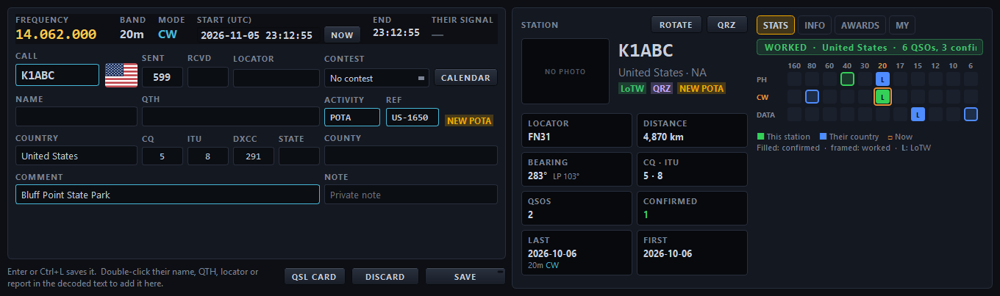
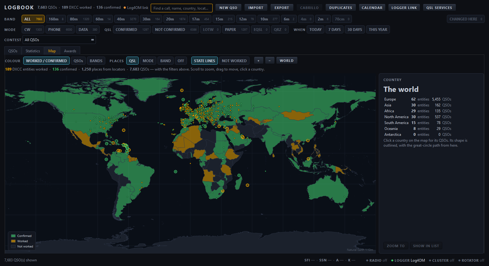
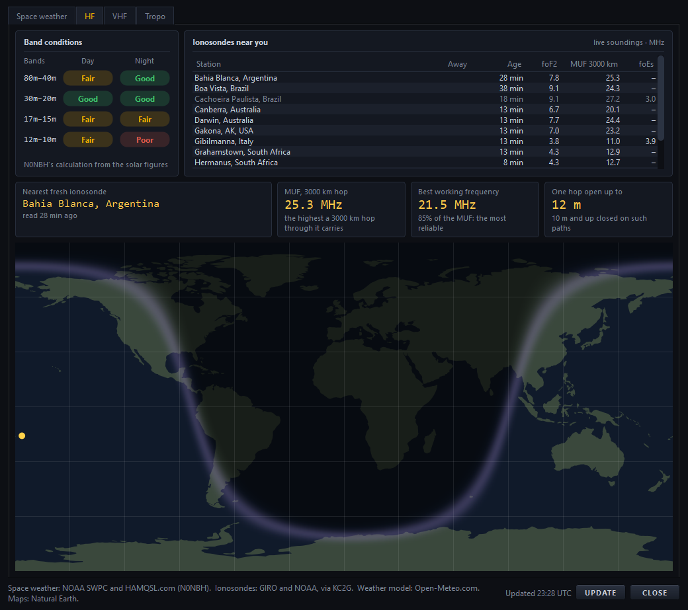
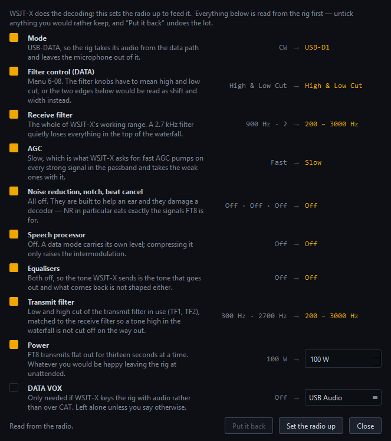
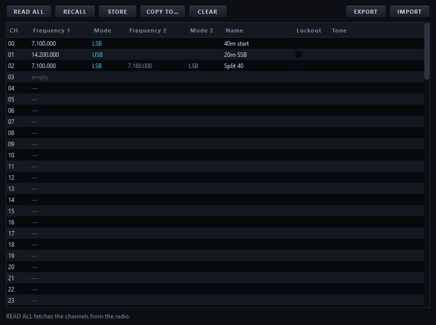

# TS-990S Desktop Front Panel

**Control your Kenwood TS-990S from your Windows PC or Mac, with both
receivers, the bandscope, a logbook, a DX cluster, FT8, CW, RTTY, PSK31 and
FreeDV built in.**

 

*The front panel. On the left the main screen: a meter and a line for each
band, then the bandscope and waterfall. In the middle the sub-screen with
the filter scope, and the two tuning knobs. On the right, the receive
controls for the main band and the sub band.*

The keys, knobs and meters look and work like the ones on the radio, and
you can move, resize and hide the groups of controls and save your own
layouts. Both receivers come through at once: the radio's USB sound has the
main band on the left and the sub band on the right, and you can hear them
in separate ears or mixed. CAT control and audio go over the radio's USB
cable, and the bandscope comes over your network.

The TS-990S sends no sound over its network port, so for operating away
from home there is the **TS-990S Remote Relay**: a small program on a
Raspberry Pi or a Windows PC beside the radio that sends both receivers'
sound to your laptop and your transmit audio back.

## A closer look

*On a wide screen there is room for more: the clock, RIT/XIT, power and
delay, DATA VOX and TCI readouts across the top, and the audio scope under
the bandscope.*

*The sub-screen in four of its six displays, as the radio's S.DISP key
picks them: the filter scope with a dial, both bands with the split between
them, and the X-Y and vector scopes for tuning RTTY and PSK.*

*Keys work as they do on the radio: press for one thing, hold for another.
Holding FIL opens the receive filter screen, with the roofing filter, IF
shape and AF filter.*

*Logging a QSO: the frequency and mode come from the radio, the country
and zones from the call, and QRZ.com fills in the rest. Worked before, by
band and mode, is on the right.*

*The logbook's map: countries confirmed, worked and still to work.*

*Propagation: band conditions, the nearest ionosondes and the greyline,
updated every quarter of an hour.*

*Setting the radio up for FT8 in one go, and putting it all back after.*

*The radio's memory channels: read, stored, copied and cleared from the
computer.*

## Download

From the [latest release](https://github.com/lmacc/Kenwood-TS-990-Releases/releases/latest):

- **TS-990S-Desktop-&lt;version&gt;-setup.exe**: the Windows installer, for
  Windows 10 and 11 (64-bit).
- **TS-990S-Desktop-&lt;version&gt;-macos.dmg**: for macOS 13 and later, on
  Apple silicon and Intel Macs.
- **TS-990S-Remote-Relay-raspberry-pi.tar.gz**: the Remote Relay for a
  Raspberry Pi beside the radio. The Windows relay comes with the installer.
- **SHA256SUMS.txt**: a checksum for each file.

> **"Windows protected your PC"?** The installer isn't signed. Click
> **More info**, then **Run anyway**. On a Mac, the README in the disk image
> says how to open it the first time.

## Before you start

- Kenwood's virtual COM port driver installed, so the radio's USB ports
  appear.
- On the radio: menu **7-01** (USB baud rate) at **115200**, and menu
  **7-16** (USB audio output) at **Normal**, so the two receivers come
  through apart.
- For the bandscope over your network, or for using the radio over the
  network: the radio's LAN screen set up (MENU, then LAN), with its IP
  address, Administrator ID and password. Change the password from
  Kenwood's default.

The user guide, inside the application under **ABOUT**, then **USER GUIDE**,
covers every control and how to set everything up, with pictures.

## Licence keys

Free to use, and free to pass on unchanged. After three weeks it reminds you
to consider a donation. A donation of EUR 20 or more gets you a licence key
for your computer, which ends the reminders, with free updates for life.
**ABOUT**, then **LICENCE KEY**, shows your computer's code: put it in the
note with your donation. TS-990S Desktop has keys of its own; a TS-890S
Desktop key does not unlock it.

## Problems and suggestions

Please use [Issues](https://github.com/lmacc/Kenwood-TS-990-Releases/issues).
Say which version you have (ABOUT shows it, with the radio's firmware), and
copy in what the CAT log at the bottom of the window says.

73, Leslie EI5GJB
